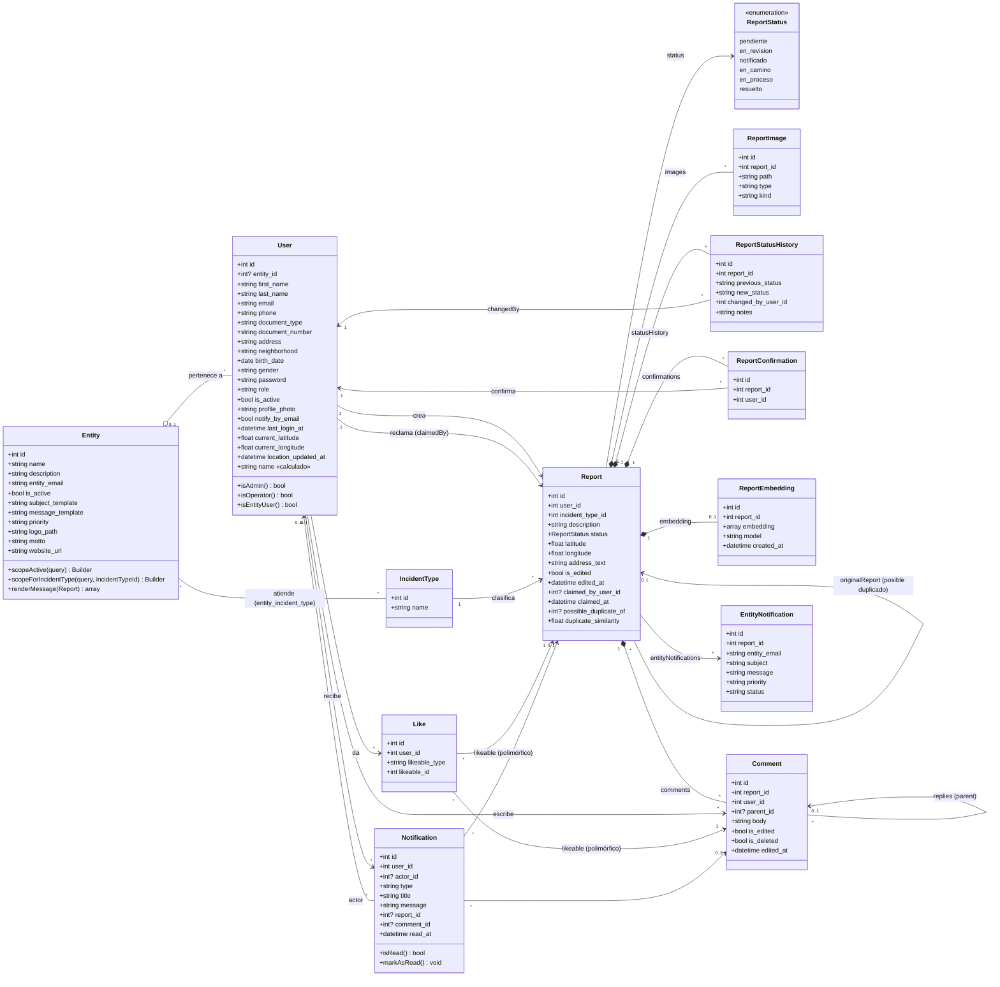
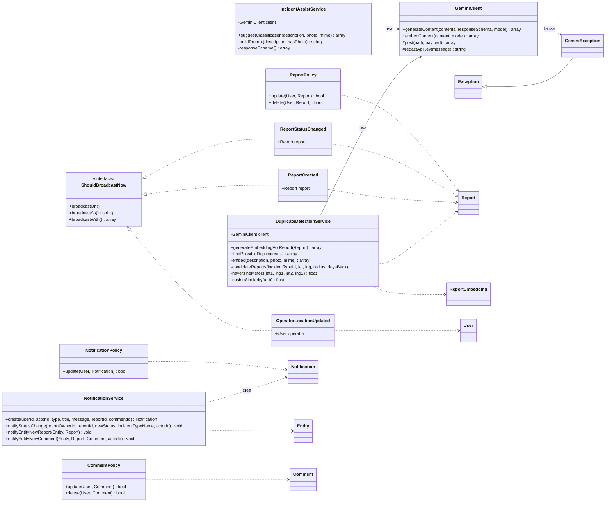

# Diagrama de clases — Ojo en la Vía

Generado a partir de `app/Models`, `app/Services`, `app/Events` y `app/Policies`.

## 1. Modelo de dominio

## 2. Servicios, eventos y políticas

## Notas

- Todos los modelos heredan de `Illuminate\Database\Eloquent\Model`; `User` hereda de `Authenticatable`.
- `User.role` toma los valores `ciudadano`, `admin`, `operator` y `entity`.
- `Like` es una relación polimórfica (`likeable`): puede apuntar a un `Report` o a un `Comment`.
- `Report.comments` devuelve solo comentarios de primer nivel; las respuestas se anidan con `parent_id`.
