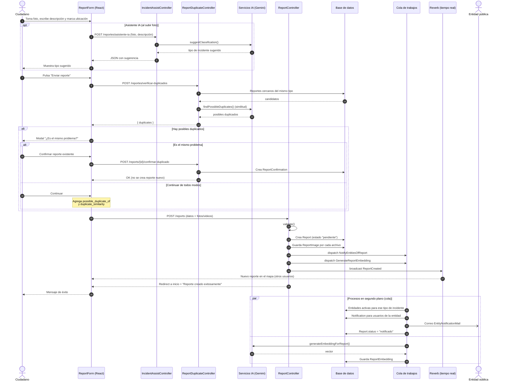

# Diagrama de secuencia — Crear un reporte

Flujo real según `ReportForm.tsx`, `IncidentAssistController`, `ReportDuplicateController`,
`ReportController::store` y los jobs `NotifyEntitiesOfReport` / `GenerateReportEmbedding`.

